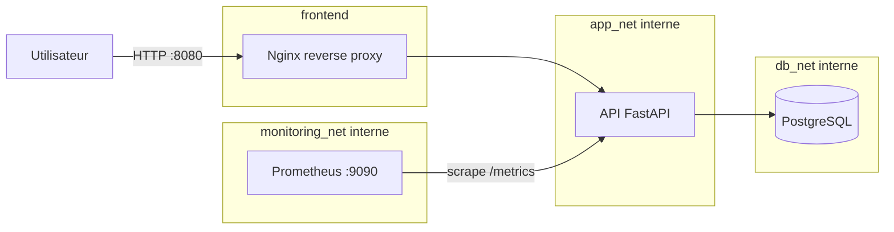

# SecureCloudLab — Infrastructure conteneurisée et sécurisée

Mini-projet DevOps / réseau conçu pour démontrer une architecture multi-services avec **Docker Compose**, un **reverse proxy Nginx**, une **API Python**, une base **PostgreSQL**, une supervision **Prometheus** et une pipeline **GitHub Actions**.

## Objectifs

- Conteneuriser plusieurs services indépendants.
- Segmenter les communications réseau entre exposition publique, application, base de données et supervision.
- Exposer uniquement Nginx au trafic applicatif externe.
- Conserver les données PostgreSQL dans un volume persistant.
- Ajouter des mesures de sécurité simples : utilisateur non-root pour l'API, `no-new-privileges`, Nginx en lecture seule, en-têtes HTTP de sécurité, rate limiting et secrets hors du dépôt.
- Superviser l'API grâce à Prometheus.
- Automatiser tests, validation Compose et build avec GitHub Actions.

## Architecture



## Arborescence

```text
SecureCloudLab/
├── app/
│   ├── Dockerfile
│   ├── main.py
│   └── requirements.txt
├── nginx/
│   └── nginx.conf
├── prometheus/
│   └── prometheus.yml
├── tests/
│   └── test_smoke.py
├── .github/workflows/
│   └── ci.yml
├── .env.example
├── .gitignore
├── docker-compose.yml
└── README.md
```

## Lancement

### 1. Préparer l'environnement

```bash
cp .env.example .env
```

Remplace `POSTGRES_PASSWORD` dans `.env` par un mot de passe long et aléatoire.

### 2. Démarrer les services

```bash
docker compose up -d --build
```

### 3. Vérifier

- Nginx : `http://localhost:8080/`
- Santé API : `http://localhost:8080/health`
- Notes : `http://localhost:8080/api/notes`
- Prometheus : `http://localhost:9090/`

Créer une note :

```bash
curl -X POST http://localhost:8080/api/notes \
  -H "Content-Type: application/json" \
  -d '{"content":"Premier test SecureCloudLab"}'
```

Puis :

```bash
curl http://localhost:8080/api/notes
```

## Segmentation réseau

| Réseau | Services | Rôle |
|---|---|---|
| `frontend` | Nginx | point d'entrée |
| `app_net` | Nginx, API | trafic applicatif interne |
| `db_net` | API, PostgreSQL | accès base de données isolé du proxy |
| `monitoring_net` | API, Prometheus | supervision |

Les réseaux `app_net`, `db_net` et `monitoring_net` sont déclarés `internal: true` afin de réduire leur exposition directe.

## Sécurité mise en place

- PostgreSQL n'a aucun port publié sur l'hôte.
- Identifiants via `.env` non versionné.
- API lancée avec un utilisateur non-root dans son conteneur.
- `no-new-privileges` activé sur les services concernés.
- Nginx monte sa configuration en lecture seule et son conteneur est `read_only`.
- En-têtes HTTP : `X-Content-Type-Options`, `X-Frame-Options`, `Referrer-Policy`.
- Rate limiting basique sur `/api/`.
- Healthchecks Docker pour l'API et PostgreSQL.
- Images versionnées au lieu de `latest`.

## Supervision Prometheus

L'API expose `/metrics` avec notamment :

- `securecloud_http_requests_total`
- `securecloud_http_request_duration_seconds`

Exemple de requête PromQL :

```promql
rate(securecloud_http_requests_total[5m])
```

## CI avec GitHub Actions

À chaque push/PR, la pipeline :

1. installe Python 3.12 et `pytest` ;
2. exécute les tests de structure ;
3. valide `docker compose config` ;
4. construit l'image de l'API.

## Commandes utiles

```bash
# Voir l'état
docker compose ps

# Logs
docker compose logs -f

# Arrêter
docker compose down

# Arrêter et supprimer aussi les volumes (efface les données)
docker compose down -v
```

## Points à expliquer en entretien

- Pourquoi un reverse proxy est placé devant l'API.
- Pourquoi PostgreSQL ne publie pas son port vers l'hôte.
- Différence entre réseau Docker public et `internal`.
- Rôle des volumes persistants.
- Intérêt d'un healthcheck.
- Pourquoi les secrets ne doivent pas être committés dans GitHub.
- Ce que collecte Prometheus et comment lire une métrique.
- Ce que la CI vérifie avant une mise en production.

## Améliorations possibles

- HTTPS avec certificats TLS.
- Grafana pour les tableaux de bord.
- Alertmanager pour les alertes.
- Scan de vulnérabilités Trivy dans GitHub Actions.
- Docker secrets / Vault pour la gestion avancée des secrets.
- Déploiement sur une VM Linux avec pare-feu UFW et fail2ban.
